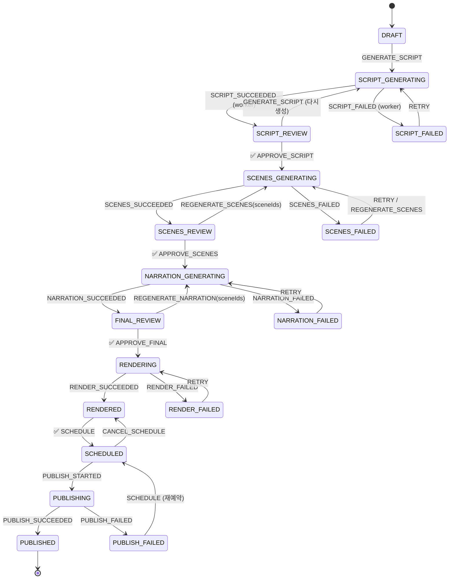

# 03. 상태 전이

구현: [`src/domain/pipeline.ts`](../src/domain/pipeline.ts) · 테스트: [`src/domain/pipeline.test.ts`](../src/domain/pipeline.test.ts)

## 1. 프로젝트 상태



✅ = 사용자 승인. 워크플로 5·6단계(나레이션·자막 생성, 최종 미리보기 승인)는 `FINAL_REVIEW` 하나의 게이트로 합친다: 나레이션과 자막이 입혀진 최종 Player 미리보기를 보고 승인한다. 이 화면에서 자막 텍스트 수정과 장면별 나레이션 재생성이 가능하다.

## 2. 수정 이벤트와 초기화 규칙

| 이벤트 | 허용 상태 | 결과 상태 | 초기화되는 승인 | 기타 부수효과 |
| --- | --- | --- | --- | --- |
| `EDIT_SCRIPT` (대본·장면 텍스트·길이 수정) | SCRIPT_REVIEW ~ SCHEDULED 중 편집 가능 상태 | SCRIPT_REVIEW | script, scenes, final | 렌더 무효화, 예약 취소 |
| `EDIT_SCENE` (장면 visual prompt 수정) | SCENES_REVIEW 이후 편집 가능 상태 | SCENES_REVIEW | scenes, final | 해당 장면 visual `stale`, 렌더 무효화, 예약 취소 |
| `REGENERATE_NARRATION` (보이스·장면 나레이션 재생성) | FINAL_REVIEW 등 장면 승인 이후 | NARRATION_GENERATING | final | 해당 장면 narration `stale` |
| `EDIT_CAPTIONS` (자막 텍스트만 수정) | FINAL_REVIEW, RENDER_FAILED, RENDERED, SCHEDULED | FINAL_REVIEW | final | 렌더 무효화, 예약 취소 |

"편집 가능 상태" = `*_GENERATING`, `RENDERING`, `PUBLISHING`, `PUBLISHED` 가 **아닌** 상태. 생성 중 수정은 경쟁 조건을 만들기 때문에 잠근다(필요 시 M2 에서 "생성 취소" 이벤트 추가).

대본을 수정해도 **바뀌지 않은 장면은 재생성하지 않는다.** 장면 승인은 초기화되지만, 다음 생성 시 `visual_input_hash` 가 같으면 기존 asset 을 재사용한다 (비용 0).

`PUBLISHED` 는 종단 상태다. 게시 후 수정이 필요하면 "프로젝트 복제" 로 새 프로젝트를 만든다 (M5).

## 3. 장면 단위 상태 (`scene_part_status`)

```
pending → generating → ready
                    ↘ failed → generating (재시도)
ready → stale (수정됨) → generating
```

- 집계: `aggregateSceneStatuses()` — 하나라도 pending/generating → 진행중, 모두 ready → 성공, 그 외 → 실패.
- `APPROVE_SCENES` 서버 가드: 모든 장면 `visual_status = ready` (stale 불가).
- `APPROVE_FINAL` 서버 가드: 모든 장면 `narration_status = ready`.

## 4. 작업(job) 상태

`queued → running → succeeded | failed`, 사용자 취소·대체 시 `canceled`.
- Trigger.dev 재시도(`maxAttempts`) 동안 job 은 `running` 유지, `attempt` 증가.
- 최종 실패 시에만 `failed` + 프로젝트 `*_FAILED` 이벤트.
- `ProviderError.retryable=false`(입력/정책 오류)는 `AbortTaskRunError` 로 즉시 실패.

## 5. 발행 상태 (`publication_status`)

`scheduled → publishing → published | failed`, `scheduled → canceled`.
- 실패한 발행은 **자동 재시도하지 않는다** (`RETRY` 거부). 컨테이너는 생성됐지만 게시 여부가 불확실한 경우가 있으므로 사용자가 상태를 확인한 뒤 재예약한다. 재예약 시 `ig_media_id` 가 이미 있으면 게시 완료로 정정한다.

## 6. 규칙 요약 (테스트로 보장)

- 승인 이벤트는 해당 검수 상태에서만 허용 (전 상태 전수 테스트).
- 성공 상태는 워커 이벤트로만 도달, 사용자 API 는 워커 이벤트를 거부.
- 수정 시 후속 승인 초기화, 렌더 무효화, 예약 취소.
- 진행 중 상태에서 수정 불가, PUBLISHED 종단.
